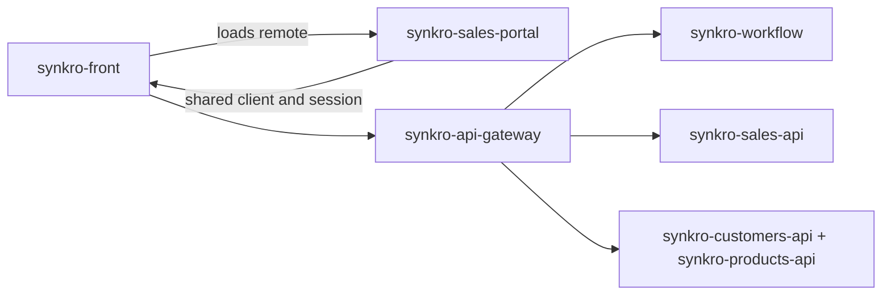

# synkro-sales-portal

> Sales web remote for saga-based registration, history, details, commercial documents and reporting.

Part of the **SynkroTech SAS Sales Management System**. Architecture, decisions and
contracts live in [synkro-docs](https://github.com/code-corhuila/synkro-docs).

**Quick start:** from this root with Node 22, run `npm ci` and `npm run build`; mount the compiled remote through synkro-front. See [Getting started](#getting-started).

## What it does

- Builds a cart and registers a sale only through the Workflow saga.
- Searches active customers through the bounded Customers search API and reads the Products catalog.
- Displays authorized history, composed detail, reports and dashboard contributions.
- Generates PDF/XML commercial documents from persisted sale amounts and configured issuer data.
- Uses the Host client/session and preserves registration intent under the supported session contract.

## Where it fits



The standalone page is not a second authenticated application. The Host supplies session, transport, global navigation and the browser-facing backend origin.

## Tech stack

| Component | Choice |
|---|---|
| Language / UI | TypeScript; React 19 |
| Build | Vite; @originjs/vite-plugin-federation |
| Tests | Vitest; compiled boundary checks; isolated Pact tooling |
| Runtime | NGINX remote, exposed internally on platform |

## Dependencies

| Depends on | Purpose | Configuration |
|---|---|---|
| synkro-front | Shared client, identity and remote entry | VITE_SHELL_ENTRY_URL |
| synkro-workflow, synkro-sales-api, synkro-customers-api and synkro-products-api | Published domain operations | Host client through gateway |

## Getting started

Use **PowerShell or Bash** from this repository root with Node 22. Prepare local build inputs from `.env.example`.

```text
npm ci
npm run build
npm run preview
```

Build the remote before loading it in the Host. Preview is for local assets; the authenticated UI is mounted through the Host. For a container deployment, the Host serves the owning `/remotes/sales/` prefix.

For the complete platform, start from [synkro-infra-postgres](https://github.com/code-corhuila/synkro-infra-postgres).

## Configuration

The committed [.env.example](.env.example) is the configuration inventory.
Its values are examples; required inputs and defaults follow its comments and the
owning implementation. Keep real secrets in protected local files.

| Variable | Purpose |
|---|---|
| `VITE_SHELL_ENTRY_URL` | Connection address, origin or build-time entry point |
| `HOST_ORIGIN` | Connection address, origin or build-time entry point |
| `VITE_ISSUER_LEGAL_NAME` | Vite issuer legal name |
| `VITE_ISSUER_TAX_ID` | Vite issuer tax id |
| `VITE_ISSUER_ADDRESS` | Vite issuer address |
| `VITE_ISSUER_PHONE` | Vite issuer phone |
| `VITE_ISSUER_EMAIL` | Vite issuer email |
| `VITE_BASE_PATH` | Connection address, origin or build-time entry point |

Browser build inputs and runtime NGINX inputs differ. VITE_* changes require rebuilding; HOST_ORIGIN controls the served origin where declared in deploy/compose.yml.

## Interface

| Entry / route | Use |
|---|---|
| ./App and ./DashboardSummary | Exposed federation modules |
| /sales | ADMIN / SALESPERSON history and new sale |
| /sales/{id} | Authorized detail and PDF/XML downloads |
| /sales/reports/... | Authorized daily, monthly and top-product views |

Customer search uses `POST /api/v1/customers/search`. Saga registration never sends SERVICE credentials or authoritative prices from the browser. PDF/XML output is a commercial document; fiscal electronic invoicing is outside this interface.

## Project structure

```text
src/sales/      API calls, saga state, pages and components
src/sales/document/ common document model, PDF and XML
src/sales/export/   history workbook export
deploy/         remote image, issuer build inputs and NGINX
scripts/        compiled-output checks
tests/pact/     isolated consumer contract tooling
docs/           registration, document and report design
```

## Testing

```text
npm run lint
npm test
npm run build
npm run check:compiled
npm run test:contract
```

Unit tests use Host doubles; they do not certify a real backend deployment. Detailed delivery notes retain their original reported test and browser-evidence limits.

## Branching and contributing

Use a `feat/`, `fix/` or `chore/` child branch and a PR into `develop`.
Permanent branches are `develop`, `qa` and `main`; none accepts direct commits.
Promote through a `qa-<description>` or release child with `git cherry-pick -x`.
`main` requires approval from `ariel5253`. Use English Conventional Commits.
See [Git conventions](https://github.com/code-corhuila/synkro-docs/blob/main/00-governance/git-conventions.md).

## Further documentation

- [History behavior](docs/history-behavior.md).
- [Registration and detail](docs/registration-and-detail.md).
- [Commercial documents](docs/commercial-documents.md).
- [Deployment](docs/deployment.md).
- [Domain rules](https://github.com/code-corhuila/synkro-docs/blob/main/02-domain/entities-and-rules.md), [contracts](https://github.com/code-corhuila/synkro-docs/tree/main/07-api/contracts/openapi) and [testing strategy](https://github.com/code-corhuila/synkro-docs/blob/main/11-quality/testing-strategy.md).

<!-- Preserve previously published README section links. -->
<a id="hu-ven-11--historial-real"></a>
<a id="hu-ven-12--registro-por-saga-y-detalle-compuesto"></a>
<a id="hu-ven-19--comprobante-de-venta-en-pdf-y-xml"></a>
<a id="contenedor-y-ci"></a>
<a id="branching"></a>
<a id="internal-root-delivery"></a>
<a id="consumer-contract-verification"></a>
